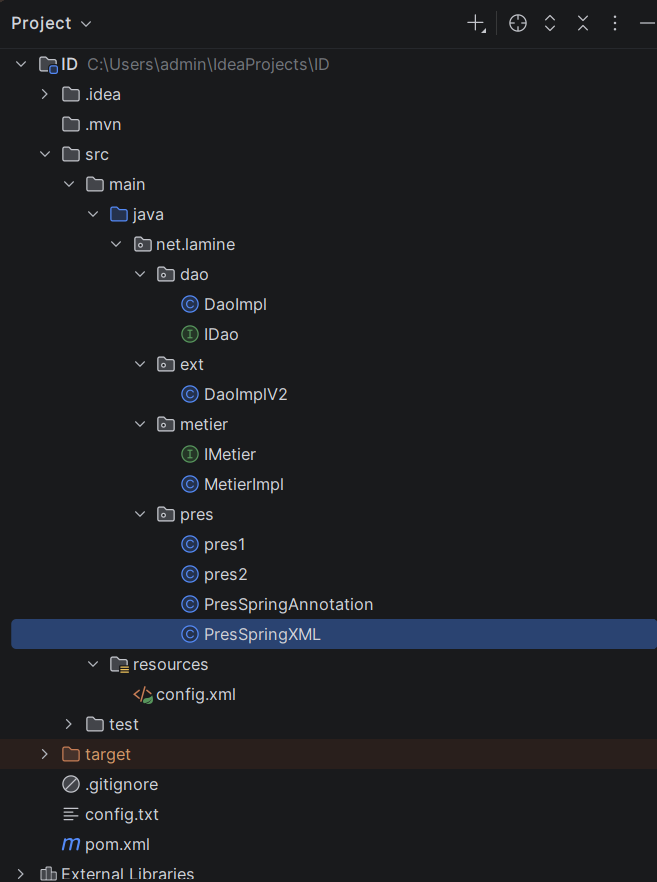
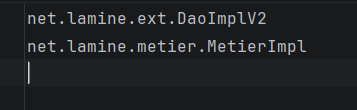
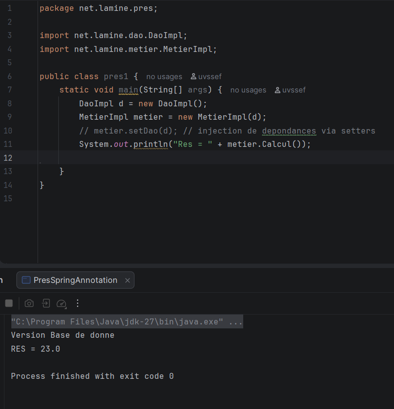
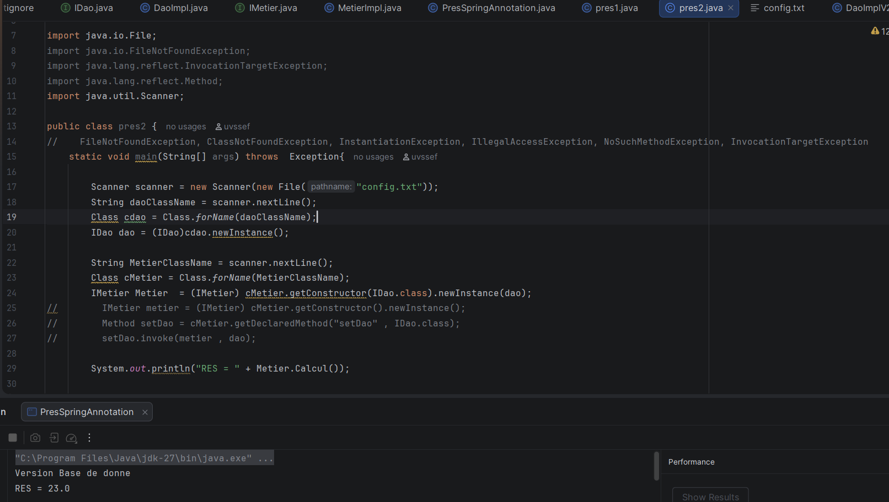
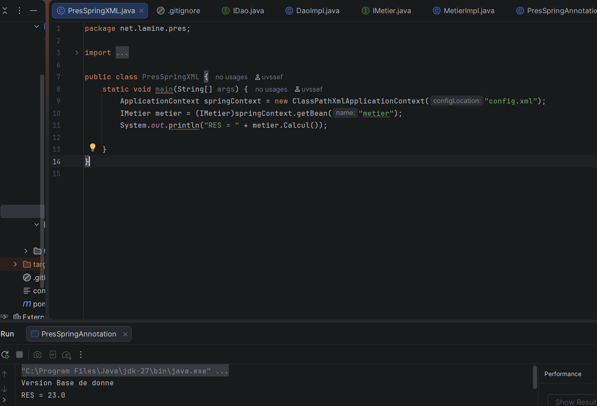
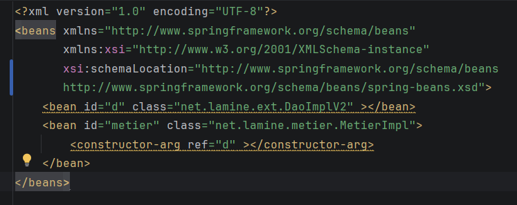
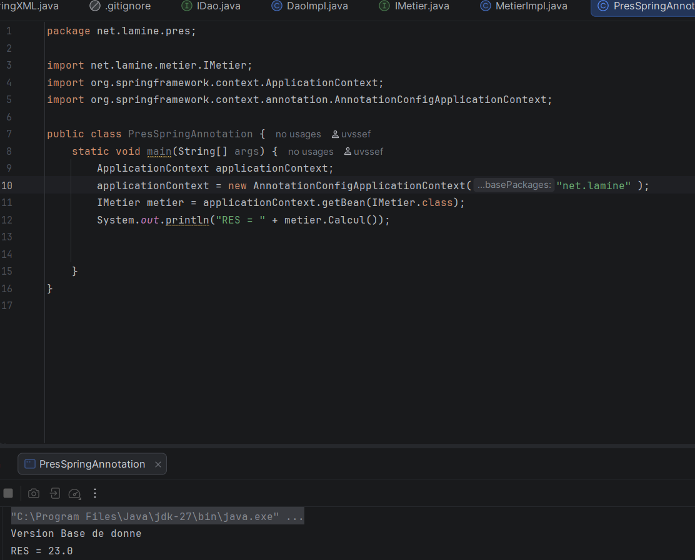

# Activité Pratique N°1 — Inversion de Contrôle (IoC) et Injection des Dépendances (DI)

**Auteur :** Youssef Lamine  
**Module :** Architecture JEE et Java avancé (2ACI)  
**Référence vidéo :** [TP IoC & DI — Architecture JEE](https://www.youtube.com/watch?v=vOLqabN-n2k)

---

## 1. Objectifs de l'activité

Cette activité pratique a pour objectif de mettre en œuvre plusieurs concepts fondamentaux de l'architecture logicielle en Java :

- **Couplage faible :** séparer les composants grâce aux interfaces.
- **Principe d'inversion des dépendances (DIP) :** les modules de haut niveau dépendent d'abstractions plutôt que de classes concrètes.
- **Injection des dépendances (DI) :**
  - injection statique, par instanciation directe avec `new` ;
  - injection dynamique, à l'aide de l'API Reflection et d'un fichier de configuration ;
  - injection avec Spring, par configuration XML et par annotations.
- **Principe Open/Closed (OCP) :** faciliter l'évolution de l'application sans modifier le code métier.

## 2. Technologies et prérequis

- Java JDK 17 ou version supérieure
- Maven
- Spring Framework
- Un IDE Java (IntelliJ IDEA, Eclipse ou VS Code avec les extensions nécessaires)

## 3. Structure du projet

```text
Activite-Pratique-1-Injection-Dependances/
├── screenshot/
│   ├── config_txt.png
│   ├── execution_statique.png
│   ├── execution_dynamique.png
│   ├── execution_spring.png
│   ├── spring_annotations.png
│   ├── spring_xml.png
│   └── structure_projet.png
├── config.txt
├── pom.xml
└── src/
    └── main/
        └── java/
            └── net/
                └── lamine/
                    ├── dao/
                    │   ├── IDao.java
                    │   └── DaoImpl.java
                    ├── ext/
                    │   └── DaoImplV2.java
                    ├── metier/
                    │   ├── IMetier.java
                    │   └── MetierImpl.java
                    └── pres/
                        ├── Pres1.java
                        ├── Pres2.java
                        ├── PresSpringXML.java
                        └── PresSpringAnnotation.java
```

> **Remarque :** adaptez l'arborescence ci-dessus à l'organisation réelle de vos fichiers. Les classes Spring peuvent nécessiter des fichiers de configuration XML ou des annotations supplémentaires selon l'implémentation choisie.

## 4. Présentation de l'architecture

Le projet est organisé en trois couches principales :

- **DAO (Data Access Object) :** fournit les données.
- **Métier :** utilise le DAO pour effectuer un calcul.
- **Présentation :** lance l'application et configure les dépendances.

### 4.1. Couche DAO

L'interface `IDao` définit le contrat d'accès aux données :

```java
package net.lamine.dao;

public interface IDao {
    double getData();
}
```

L'implémentation `DaoImpl` simule un accès à une base de données :

```java
package net.lamine.dao;

public class DaoImpl implements IDao {
    @Override
    public double getData() {
        System.out.println("==> Version Base de Données");
        return 10.0;
    }
}
```

Une deuxième implémentation, `DaoImplV2`, simule un accès à un service Web :

```java
package net.lamine.ext;

import net.lamine.dao.IDao;

public class DaoImplV2 implements IDao {
    @Override
    public double getData() {
        System.out.println("==> Version Web Service");
        return 20.0;
    }
}
```

L'utilisation de l'interface `IDao` permet de remplacer une implémentation par une autre sans changer la logique métier.

### 4.2. Couche métier

L'interface `IMetier` définit l'opération métier :

```java
package net.lamine.metier;

public interface IMetier {
    double calcul();
}
```

La classe `MetierImpl` dépend de l'abstraction `IDao` :

```java
package net.lamine.metier;

import net.lamine.dao.IDao;

public class MetierImpl implements IMetier {
    private IDao dao;

    public MetierImpl() {
    }

    // Injection par constructeur
    public MetierImpl(IDao dao) {
        this.dao = dao;
    }

    // Injection par setter
    public void setDao(IDao dao) {
        this.dao = dao;
    }

    @Override
    public double calcul() {
        double valeur = dao.getData();
        return valeur * 2;
    }
}
```

La dépendance est déclarée sous forme d'interface. La classe métier ne dépend donc pas directement de `DaoImpl` ou de `DaoImplV2`.

> **Attention :** `dao` doit être injecté avant l'appel à `calcul()`, sinon une `NullPointerException` peut se produire.

## 5. Les différentes approches d'injection

### 5.1. Injection statique — `Pres1`

Dans cette approche, les objets sont instanciés directement dans le code :

```java
package net.lamine.pres;

import net.lamine.dao.DaoImpl;
import net.lamine.metier.MetierImpl;

public class Pres1 {
    public static void main(String[] args) {
        DaoImpl dao = new DaoImpl();

        MetierImpl metier = new MetierImpl();
        metier.setDao(dao);

        System.out.println("Résultat (Statique) = " + metier.calcul());
    }
}
```

**Principe :** le programmeur crée les objets et injecte explicitement la dépendance à l'aide du setter.

### 5.2. Injection dynamique avec Reflection — `Pres2`

La classe `Pres2` lit les noms des classes dans `config.txt`, instancie les objets grâce à Reflection, puis injecte le DAO dans la couche métier.

Contenu attendu de `config.txt` :

```text
net.lamine.ext.DaoImplV2
net.lamine.metier.MetierImpl
```

Exemple de code :

```java
package net.lamine.pres;

import net.lamine.dao.IDao;
import net.lamine.metier.IMetier;

import java.io.File;
import java.lang.reflect.Method;
import java.util.Scanner;

public class Pres2 {
    public static void main(String[] args) throws Exception {
        try (Scanner scanner = new Scanner(new File("config.txt"))) {
            // Instanciation dynamique du DAO
            String daoClassName = scanner.nextLine().trim();
            Class<?> cDao = Class.forName(daoClassName);
            IDao dao = (IDao) cDao.getDeclaredConstructor().newInstance();

            // Instanciation dynamique de la couche métier
            String metierClassName = scanner.nextLine().trim();
            Class<?> cMetier = Class.forName(metierClassName);
            IMetier metier = (IMetier) cMetier.getDeclaredConstructor().newInstance();

            // Injection via le setter setDao
            Method method = cMetier.getMethod("setDao", IDao.class);
            method.invoke(metier, dao);

            System.out.println("Résultat (Dynamique) = " + metier.calcul());
        }
    }
}
```

**Principe :** l'implémentation du DAO peut être changée dans le fichier de configuration, sans modifier `Pres2`, à condition que la classe choisie implémente `IDao` et respecte le contrat attendu.

**Point important :** `config.txt` doit être accessible depuis le répertoire de travail utilisé lors de l'exécution. Pour une application plus robuste, on peut le charger depuis le classpath.

### 5.3. Injection avec Spring

Spring fournit un conteneur IoC qui crée et gère les objets (beans), puis résout leurs dépendances.

Deux modes de configuration sont prévus dans ce TP :

- **Configuration XML :** les beans et leurs relations sont déclarés dans un fichier XML.
- **Configuration par annotations :** les classes sont déclarées comme composants et leurs dépendances sont injectées à l'aide d'annotations Spring, par exemple `@Component` et `@Autowired`, ou par injection de constructeur.

Les classes `PresSpringXML` et `PresSpringAnnotation` servent à démarrer le contexte Spring correspondant.

> Les fichiers de configuration et le code exact des classes Spring ne sont pas inclus dans les extraits fournis ici. Ajoutez-les à cette documentation si vous souhaitez détailler précisément ces deux variantes.

## 6. Compilation et exécution

### Prérequis

Vérifiez que Java et Maven sont installés :

```bash
java -version
mvn -version
```

### Compiler le projet

À la racine du projet, là où se trouve `pom.xml` :

```bash
mvn clean compile
```

### Exécuter les classes de présentation

Les commandes suivantes sont indicatives. Elles supposent que les dépendances sont disponibles et que le plugin Maven Exec est configuré dans `pom.xml`.

```bash
mvn exec:java -Dexec.mainClass="net.lamine.pres.Pres1"
mvn exec:java -Dexec.mainClass="net.lamine.pres.Pres2"
```

Pour les variantes Spring, utilisez la classe principale correspondante :

```text
net.lamine.pres.PresSpringXML
net.lamine.pres.PresSpringAnnotation
```

Si le plugin Exec n'est pas configuré, lancez les classes principales depuis votre IDE ou configurez le plugin dans `pom.xml`.

## 7. Résultats attendus

Avec `DaoImpl`, `getData()` retourne `10.0`, donc le calcul retourne `20.0`.

Avec `DaoImplV2`, `getData()` retourne `20.0`, donc le calcul retourne `40.0`.

Les messages affichés indiquent l'implémentation utilisée :

```text
==> Version Base de Données
Résultat (Statique) = 20.0
```

Pour l'injection dynamique configurée avec `DaoImplV2` :

```text
==> Version Web Service
Résultat (Dynamique) = 40.0
```

La sortie exacte dépend de la classe DAO configurée et du mode d'exécution.

## 8. Captures d'écran

Les captures ci-dessous documentent la structure, la configuration et les exécutions du projet. Les fichiers doivent exister dans le dossier `screenshot/` pour s'afficher correctement sur GitHub.

| Description | Capture |
|---|---|
| Structure du projet |  |
| Fichier de configuration |  |
| Injection statique |  |
| Injection dynamique |  |
| Exécution Spring |  |
| Configuration Spring XML |  |
| Configuration Spring par annotations |  |

## 9. Tableau comparatif

| Critère | Injection statique | Reflection | Conteneur Spring |
|---|---|---|---|
| Création des objets | Manuelle avec `new` | Dynamique via Reflection | Gérée par Spring |
| Configuration | Code Java | Fichier texte | XML ou annotations |
| Changement d'implémentation | Modification du code | Modification de la configuration | Modification de la configuration ou des beans |
| Gestion des dépendances | Manuelle | Manuelle par Reflection | Prise en charge par le conteneur |
| Flexibilité | Limitée | Élevée | Élevée |
| Complexité | Faible | Plus élevée (Reflection) | Faible à moyenne une fois configuré |

## 10. Conclusion

Cette activité pratique montre comment l'inversion de contrôle et l'injection des dépendances permettent de rendre une application Java plus modulaire et plus facile à faire évoluer.

L'injection statique illustre le mécanisme de base, Reflection permet de choisir les implémentations à partir d'une configuration externe, et Spring automatise la création des objets ainsi que la résolution de leurs dépendances.

Le recours aux interfaces, notamment `IDao` et `IMetier`, réduit le couplage entre les couches et facilite les tests ainsi que le remplacement des implémentations.

---

**Auteur :** Youssef Lamine  
**Module :** Architecture JEE et Java avancé (2ACI)
